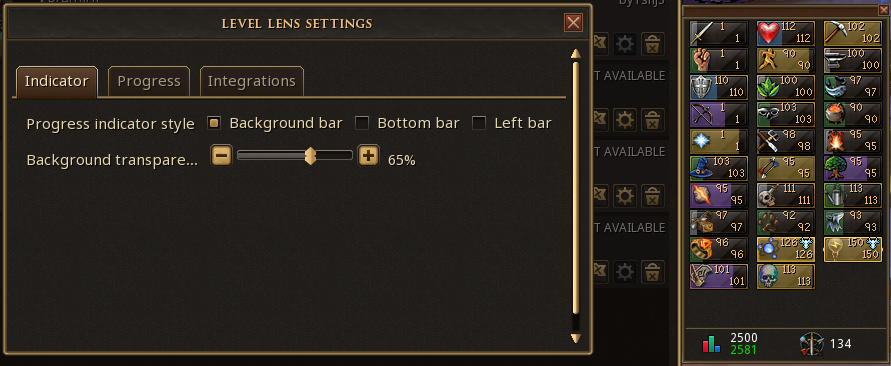
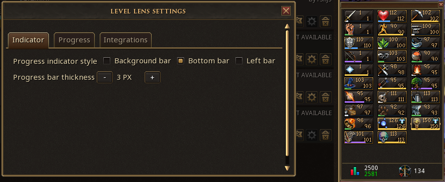
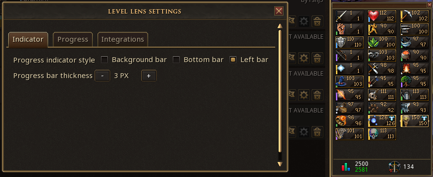
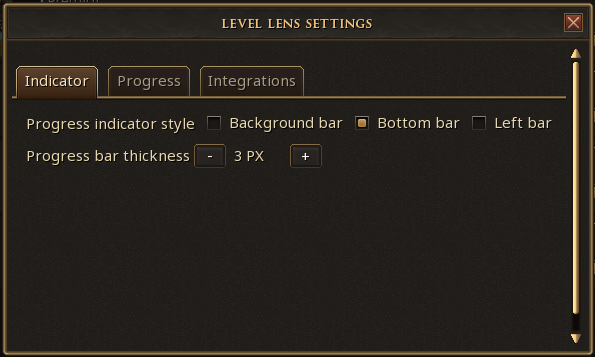
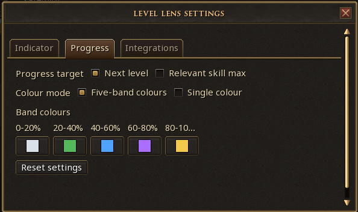
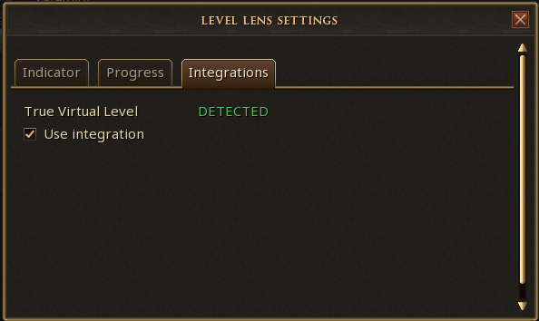

# Level Lens

Level Lens adds customisable skill-progress indicators directly to RuneScape's native Skills interface.

Track progress toward the next level or toward a skill's real level cap, customise how the indicators look, and optionally integrate with True Virtual Level for virtual-level progression.

Level Lens works standalone, but pairs especially well with the True Virtual Level plugin.

## Screenshots

### Background bar

### Bottom bar

### Left bar

### Indicator settings

### Progress settings

### Integrations

## Features

- Three indicator styles: Background bar, Bottom bar, and Left bar
- Progress toward the next level or toward the skill's real 99/110/120 level cap
- Fully customisable five-band progress colours
- Optional single-colour mode with a custom colour picker
- Background transparency control
- Configurable 1-10px thickness for Bottom and Left bars
- Native elite Invention XP-curve handling
- Optional True Virtual Level integration
- TVL integration can be enabled or disabled from Level Lens
- Tabbed settings for Indicator, Progress, and Integrations
- Reset settings button
- Persistent settings between sessions
- Indicators automatically follow the native Skills interface when it resizes

The default five-band colours are:

- 0-20%: light/white
- 20-40%: green
- 40-60%: blue
- 60-80%: purple
- 80-100%: gold

Each band colour can be customised individually.

## Progress targets

### Next level

Shows progress through the player's current level toward the next applicable level. This remains the default.

### Relevant skill max

Shows total XP progress toward the skill's real gameplay level cap:

- Level 99 skills progress toward 99
- Level 110 skills progress toward 110
- Level 120 skills progress toward 120

This is based on XP progress, not a linear percentage of level numbers. Invention respects its correct XP curve.

## True Virtual Level integration

True Virtual Level is an optional integration. Level Lens continues to work normally without TVL.

If TVL is detected, the Integrations tab displays its status and lets the player choose whether Level Lens should use it. With integration enabled, Level Lens can use TVL's virtual progression and Invention curve preferences. With integration disabled, Level Lens uses its own standalone progression calculations.

Level Lens supports True Virtual Level API 1.0 and 1.1. With API 1.1, Level Lens can use TVL's native elite Invention progression and apply a Level Lens-specific 120/126 virtual-level cap override without changing True Virtual Level's saved preferences. Older TVL API 1.0 versions remain supported through Level Lens' compatibility fallbacks.

Thanks to Nyx-Asteria for contributing the initial True Virtual Level compatibility work.

## Settings

### Indicator

- Background, Bottom, or Left style
- Background transparency for Background mode
- 1-10px thickness for Bottom and Left modes

### Progress

- Next level or Relevant skill max target
- Five-band or Single colour mode
- Custom colour pickers
- Reset settings

### Integrations

- True Virtual Level detection status
- Toggle whether Level Lens should use TVL
- Virtual level cap control on TVL API 1.1+: Follow TVL, Cap 120, or Extend 126
- Cap overrides affect Level Lens calculations only and do not change TVL's saved settings

## Dependencies

Required:

- PrettyUI

Optional:

- True Virtual Level

True Virtual Level is not required for Level Lens to function.

## Development

This plugin is built for the official RuneScape Plugin API.
