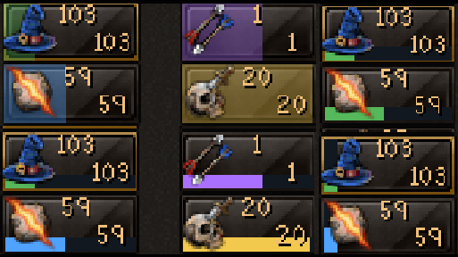
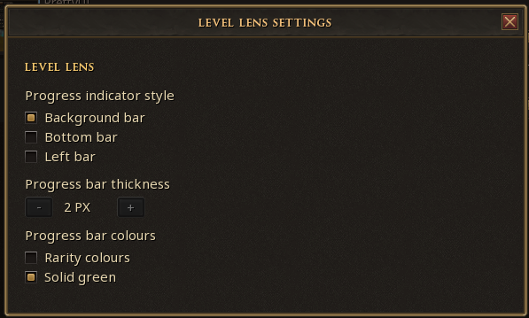
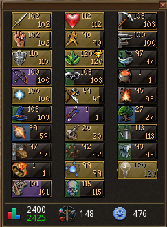
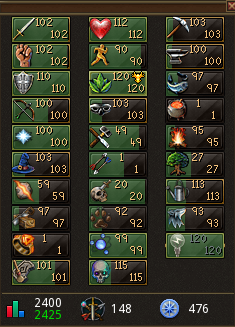
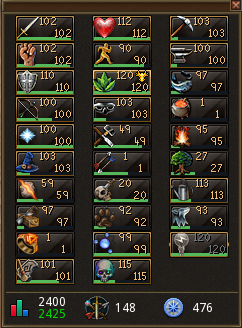

# Level Lens

## Screenshots

**Settings**

**Rarity background**

**Solid green background**

**Solid green bottom bar**

Level Lens is a RuneScape plugin that adds configurable level-progress indicators directly to the native Skills interface. It shows progress toward the next level on each skill tile.

## Features

- Three indicator styles: Background bar, Bottom bar, and Left bar
- Configurable thickness for the Bottom and Left bars
- Rarity-style progress colours or solid green
- Includes Invention's elite-skill XP curve
- Settings saved between sessions
- Indicators that follow the native Skills interface when it resizes

Rarity colours show progress as follows:

- 0–20%: light/white
- 20–40%: green
- 40–60%: blue
- 60–80%: purple
- 80–100%: gold

## Settings

Choose the indicator style, set the thickness for Bottom or Left bars, and select rarity colours or solid green.

## Development

This plugin is built for the official RuneScape Plugin API.
